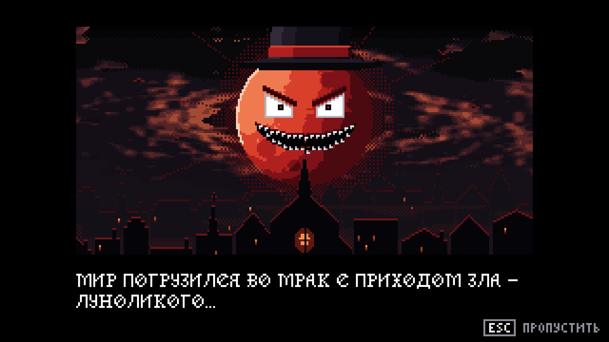
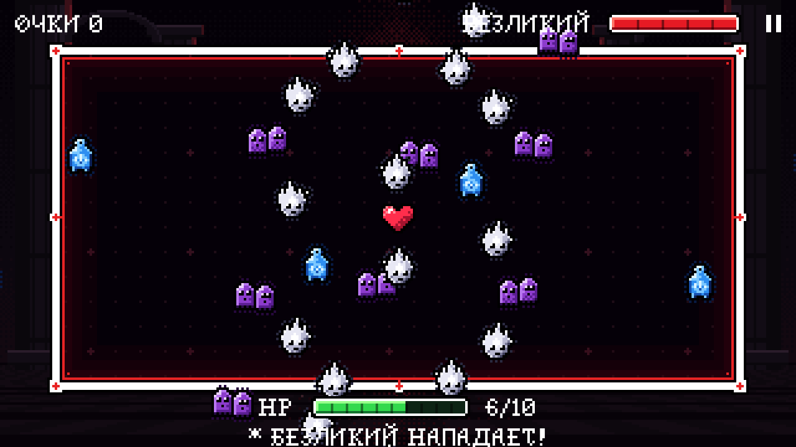
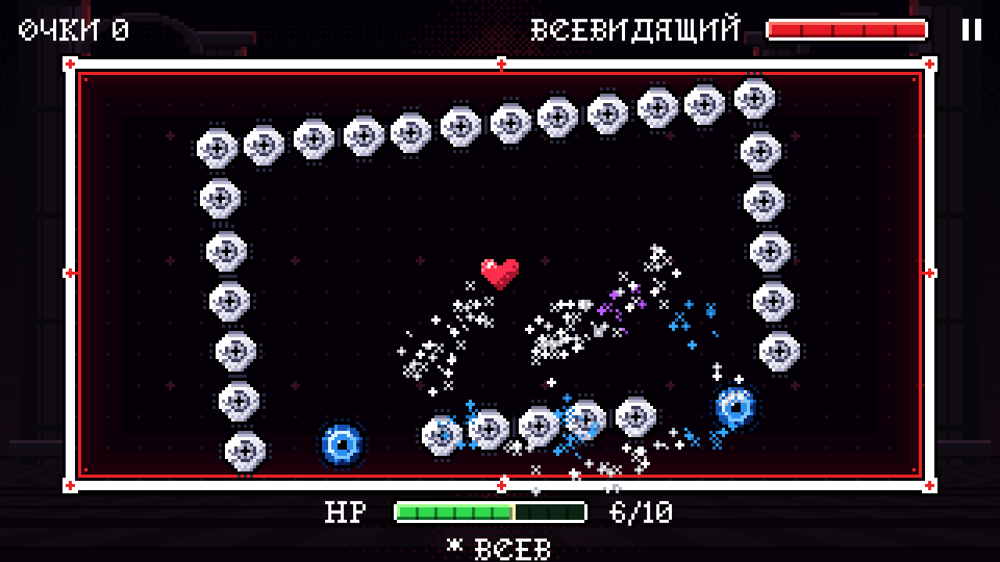
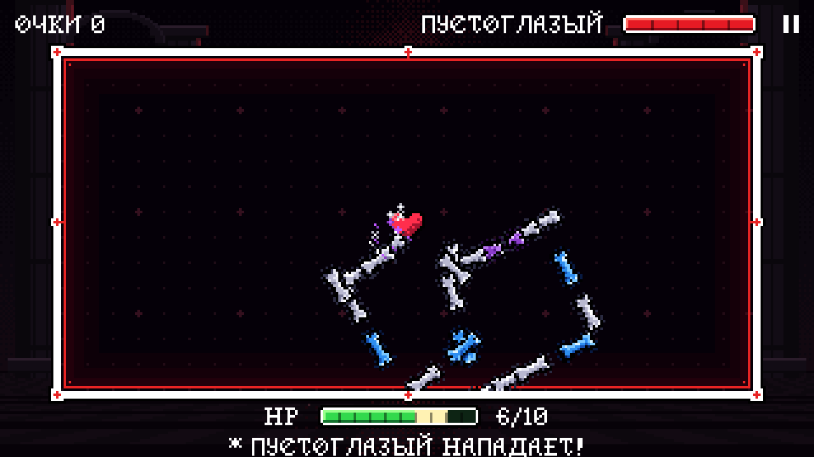
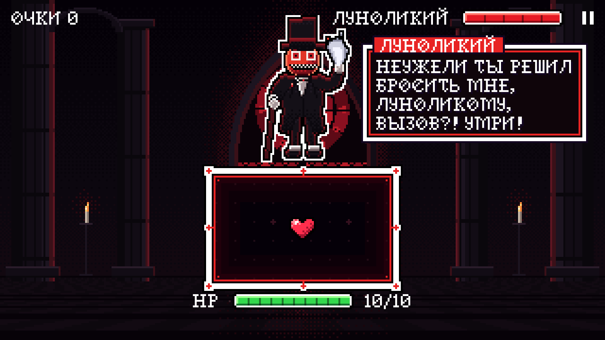
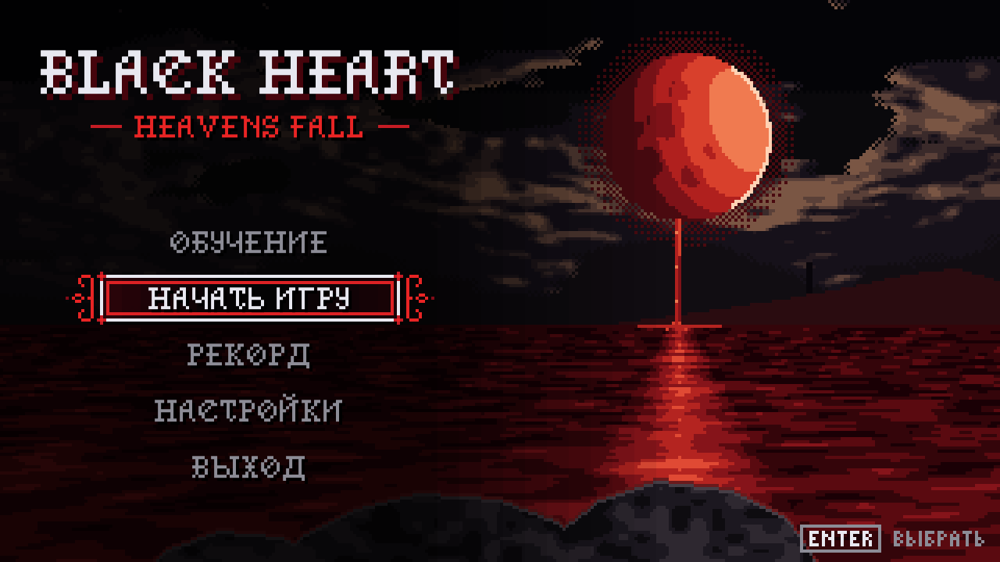
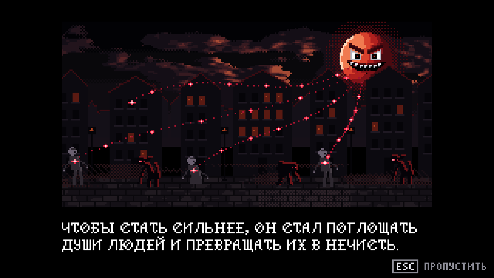
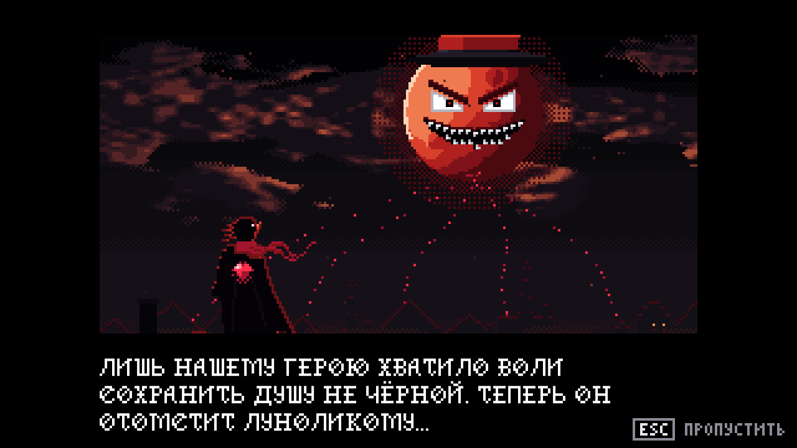

<div align="center">

# 🖤 BLACK HEART
### — HEAVENS FALL —

**Пиксельный bullet-hell, где пули не уворачиваются — их режут.**
Защити своё сердце от слуг Луноликого в духе *Undertale* и *Rhythm Doctor*.

[](https://github.com/LotWyx/black_heart/releases/latest)
[](https://github.com/LotWyx/black_heart/releases/latest)
[](https://unity.com)
[](LICENSE)



</div>

---

## 🌑 О чём игра

> *Мир погрузился во мрак с приходом зла — Луноликого…*
>
> *Чтобы стать сильнее, он стал поглощать души людей и превращать их в нечисть.*
>
> *Лишь нашему герою хватило воли сохранить душу не чёрной. Теперь он отомстит Луноликому…*

Ты — красное сердце в рамке боя. Слуги Луноликого обрушивают на тебя волны атак, и единственное оружие — **разрез**. Проведи мышью или пальцем по пулям, чтобы разрубить их, а потом успей ударить врага, пока он открыт.

<div align="center">

</div>

## ⚔️ Как играть

Бой идёт по кругу из двух фаз:

| Фаза | Что делать |
|---|---|
| 🛡️ **Защита** | Враг улетает, рамка расширяется, и на сердце летят атаки. Режь их, пока они не долетели. |
| 🗡️ **Атака** | Рамка сжимается, враг возвращается. Проведи разрез **по врагу**, пока не кончилось время. Не успел — враг смеётся и ранит тебя. |

### Типы атак

Цвет атаки всегда говорит, что с ней делать, — неважно, череп это, глаз или призрак.

| | Тип | Что делать |
|:-:|---|---|
| ⚪ | **Белая** | Режь — одного удара достаточно. |
| 🟣 | **Фиолетовая** | Режь **дважды**: после первого удара она распадается на две половинки. |
| 🔵 | **Синяя** | **Не трогай!** Разрезанная синяя ранит сердце и снимает очки. Пусть пролетит. |

### Очки

| Действие | Очки |
|---|---:|
| Разрезать белую атаку | **+10** |
| Разрезать половинку фиолетовой | **+15** |
| Защита без единого попадания — *«ЧИСТО!»* | **+50** |
| Победить врага (и +2 HP) | **+200** |
| Задеть синюю атаку | **−25** |

## 👁️ Враги

<table>
<tr>
<td width="33%" valign="top">

### Безликий
Призрак без лица. Закручивает **спирали** из душ, пускает **волны** вдоль рамки, **маятники** и мечущиеся, как мухи, огоньки.

</td>
<td width="33%" valign="top">

### Всевидящий
Огромный глаз. Взрывает **бум-круги**, сжимает вокруг сердца вращающийся **прямоугольник** из глаз и окружает синий глаз четырьмя спутниками.

</td>
<td width="33%" valign="top">

### Пустоглазый
Скелет с пустыми глазницами. Двигает **стену костей**, катит вращающиеся **клетки** и швыряет черепа кучками.

</td>
</tr>
</table>

<div align="center">


</div>

Каждый враг — 5 ударов, твоё сердце — 10 HP.

### 📈 Растущая сложность

С каждым ходом атак становится больше, они быстрее и коварнее:

- **Средняя сложность — ⚡ зигзаг-пуля.** Иногда из-за экрана врывается пуля, которая мечется по рамке
  с бешеной скоростью. На сердце она не бросается сразу: у тебя есть пара секунд, чтобы поймать момент —
  и отсчёт начинается, только когда она влетела в рамку.
- **Высокая сложность — два темпа.** Каждая атака либо **«много, но медленно»** — плотный рой с кучей
  фиолетовых, либо **«быстро, но мало синих»** — стремительно, зато почти без ловушек.
- **Честность прежде всего.** К сердцу одновременно не подлетает больше пяти пуль — остальные ждут своей
  очереди на подступах. Тяжело — да, невозможно — нет.

### И сам Луноликий

Джентльмен в цилиндре с лицом-луной встречает тебя в **обучении**: покажет, как резать, и посмеётся над твоими попытками.

<div align="center">

</div>

## 🎮 Управление

| | ПК | Телефон |
|---|---|---|
| Разрез | Зажать **ЛКМ** и провести — курсор-клинок краснеет | Провести **пальцем** |
| Меню | **↑ ↓ / W S**, **Enter**, **Esc** | Касание |
| Пауза | **Esc** или **P** | Кнопка **II** вверху справа |
| Пропустить вступление | **Esc** | Касание в правом нижнем углу |

## 📥 Скачать

1. Открой [**последний релиз**](https://github.com/LotWyx/black_heart/releases/latest).
2. Скачай `BlackHeart_vX.Y.Z_Windows.zip`.
3. Распакуй архив — появится папка `BlackHeart`. Запусти `BlackHeart.exe` внутри неё.

## 🖼️ Галерея

<div align="center">



</div>

---

## 🛠️ Для разработчиков

### Сборка из исходников

- **Unity 6000.6.5f1** (URP 17.6, Input System 1.20)
- Для билда под Windows — модуль **Windows Build Support (Mono)**

```bash
git clone git@github.com:LotWyx/black_heart.git
```

Открой папку в Unity Hub, сцена — `Assets/Scenes/Game.unity`.
Сборка: **File → Build Profiles → Windows → Build**.

> Хочешь поучаствовать? Сначала прочитай [**CONTRIBUTING.md**](CONTRIBUTING.md): ветки и Pull Request,
> как коммитить ассеты Unity вместе с `.meta`, тесты и CI. История изменений — в [CHANGELOG.md](CHANGELOG.md).

### Устройство проекта

```
Assets/
├── Scenes/Game.unity       единственная сцена — GameManager собирает всё кодом
├── Scripts/
│   ├── Runtime/            код игры (сборка BlackHeart.Runtime)
│   │   ├── Core/           GameManager, пиксельная камера 320×180, события, баланс, сохранения
│   │   ├── Battle/         цикл боя (защита ↔ атака), сложность, обучение
│   │   ├── Patterns/       атаки врагов: AttackPattern + реестр PatternLibrary
│   │   ├── Projectiles/    пули, пул и траектории — чистые функции времени
│   │   └── Enemies/ UI/ Audio/ FX/ Input/ Player/ Arena/ Art/
│   └── Editor/             правила импорта (BlackHeart.Editor)
├── Tests/EditMode/         автотесты (BlackHeart.Tests.EditMode)
└── Resources/
    ├── Data/               GameBalance.asset и враги — баланс без правки кода
    ├── Art/                спрайты (генерируются из Art/Source)
    └── Audio/Music/        Intro_ · Menu_ · Battle_ · GameOver_
Art/Source/                 Lua-генераторы пиксель-арта для Aseprite и исходники .aseprite
tools/ci/                   проверка проекта без Unity
.github/                    CI (GitHub Actions), шаблоны Pull Request и задач
```

### Тесты и CI

- **Автотесты** (*Window → General → Test Runner → EditMode*): данные врагов и баланса, правила траекторий,
  целостность `.meta`.
- **GitHub Actions** на каждый Pull Request: проверка проекта без Unity (забытые файлы и `.meta`), тесты и
  билд Windows через GameCI; тег `vX.Y.Z` собирает релиз.
- Баланс — в `Assets/Resources/Data/GameBalance.asset`, менять можно прямо в инспекторе.

### Как устроены атаки

Каждая атака — корутина `AttackPattern.Run(AttackContext)`. Траектория пули задаётся
**чистой функцией времени** (`IProjectileMotion.Evaluate(t)`), поэтому любую атаку можно
перемотать, заморозить (обучение) или разрезать на половинки, которые продолжат тот же путь.
`AttackContext` даёт паттерну сложность, рамку, цель и хелперы: подбор скорости под время
реакции, просветы вокруг синих пуль, ожидание расчистки поля.

### Графика

Весь пиксель-арт нарисован кодом: Lua-скрипты в `Art/Source/gen_*.lua` запускаются в
**Aseprite** и пишут PNG в `Assets/Resources/Art`, а исходники — в `.aseprite`.
Хочешь поправить спрайт — правь генератор и перезапускай его.

---

<div align="center">

**Black Heart** © 2026 **LotWyx** и **catCoder11**. Все права защищены — см. [LICENSE](LICENSE).
Музыка создана с помощью Suno. Шрифт Hollowetica © Caveras / Cliff ModesArt.

🖤

</div>
